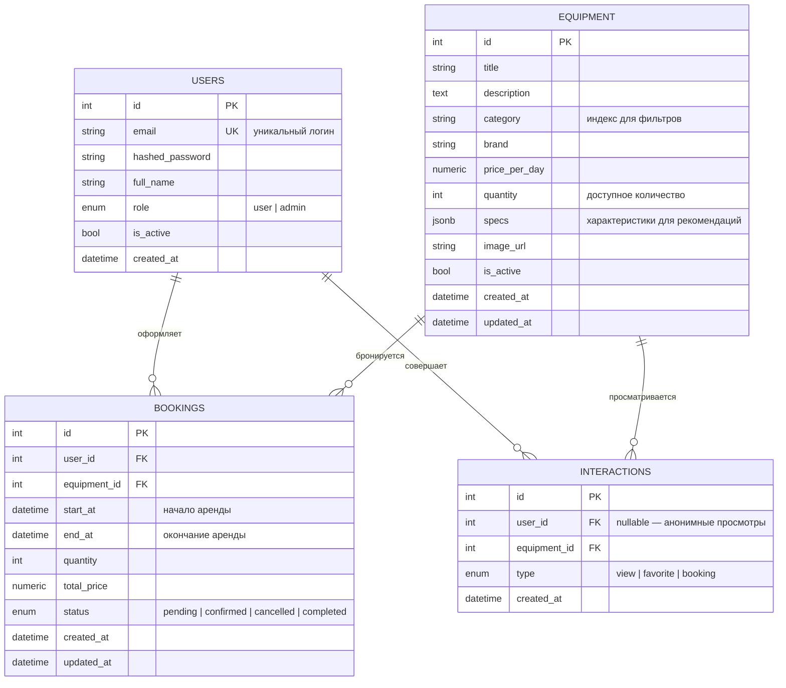

# Модель данных (ER-диаграмма)

## Ключевые решения

1. **`equipment.quantity`** — оборудование одной модели может быть в нескольких
   экземплярах, поэтому проверка пересечений считает не факт брони, а сумму
   количеств в пересекающемся интервале.
2. **`bookings` (start_at, end_at)** — интервалы полуоткрытые: бронь A и бронь B
   не конфликтуют, если `A.end_at <= B.start_at` или `B.end_at <= A.start_at`.
   Дополнительно учитывается буфер между бронями (`BOOKING_BUFFER_MINUTES`).
3. **`bookings` (equipment_id, start_at, end_at)** — составной индекс под запрос
   проверки пересечений, самый нагруженный запрос системы.
4. **`equipment.specs` (JSONB)** — произвольные характеристики (мощность, вес,
   давление и т.д.), из которых строится вектор для content-based рекомендаций.
   JSONB выбран вместо отдельной таблицы свойств, чтобы не усложнять схему.
5. **`interactions`** — история просмотров: источник данных для блока
   «популярное» и для холодного старта рекомендаций.
6. **Статусы** хранятся как `VARCHAR` (`native_enum=False`): проще миграции,
   не нужно создавать типы в PostgreSQL вручную.
